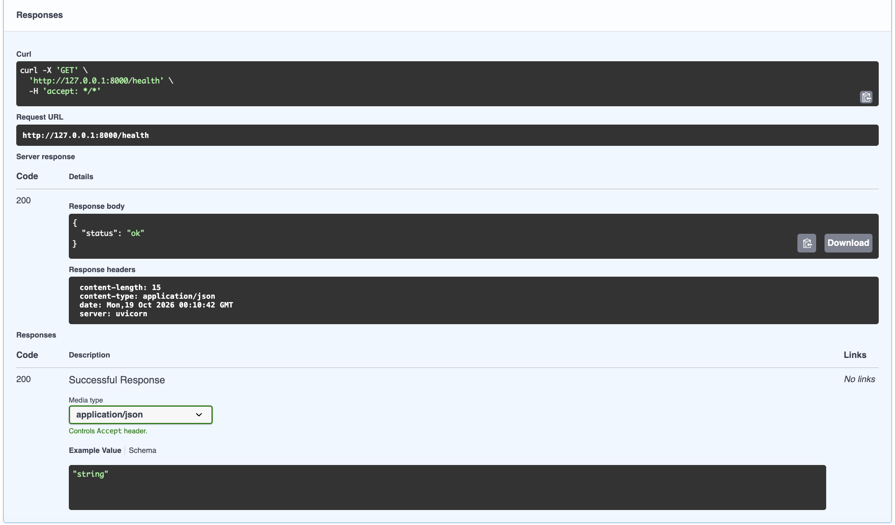
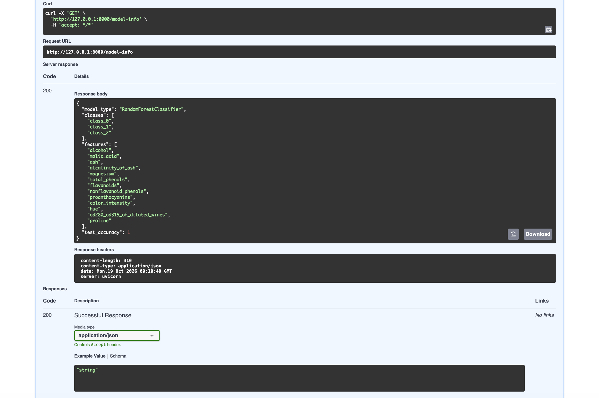
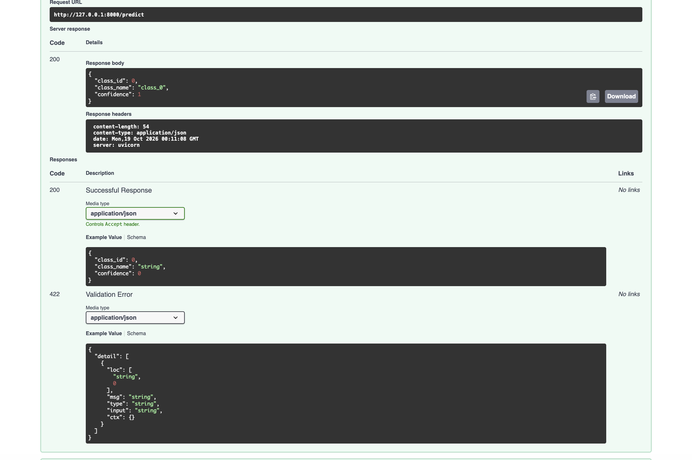
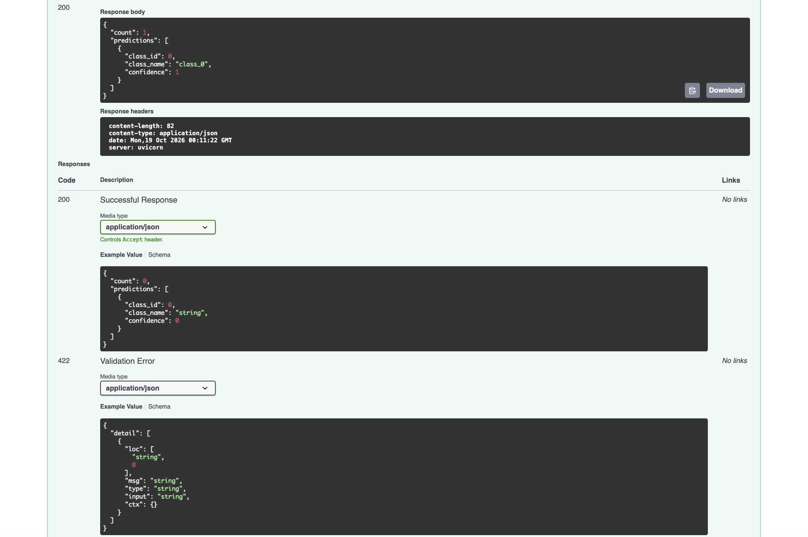

# MLOps Lab 2 - FastAPI Wine Cultivar Classifier API

This lab is based on the course's FastAPI lab and serves a scikit-learn model as a REST API with FastAPI and uvicorn. Instead of the Iris dataset from the course lab, I used the UCI Wine dataset, which has 13 chemical measurements per wine and 3 cultivar classes.

## Modifications from Original Lab

- **Dataset:** Wine (13 features, 3 classes) instead of Iris (4 features).
- **Model:** Random Forest with 200 trees instead of a Decision Tree. The saved file also stores the class names, feature order and test accuracy.
- **Endpoints:** added `/health`, `/model-info` and `/predict/batch` on top of `/predict`.
- **Response:** `/predict` returns the class id, class name and confidence instead of just the class id.
- **Validation:** all features must be >= 0 (422 otherwise), batch requests must have 1 to 50 samples (400 otherwise), and the API returns 503 if the model hasn't been trained yet.
- **Tests:** a pytest suite in `tests/` using FastAPI's `TestClient`.

## Project structure

```
├── assets/            screenshots
├── model/             wine_model.pkl is saved here by train.py
├── src/
│   ├── data.py        loads the dataset, train/test split, feature order
│   ├── train.py       trains and saves the model
│   ├── predict.py     loads the model and makes predictions
│   └── main.py        FastAPI app and endpoints
├── tests/             API tests
├── requirements.txt
└── README.md
```

## Setup

```bash
python3 -m venv fastapi_lab1_env
source fastapi_lab1_env/bin/activate
pip install -r requirements.txt
```

## Train the model

```bash
cd src
python train.py
```

## Run the API

```bash
uvicorn main:app --reload     # run from inside src/
```

Then open http://127.0.0.1:8000/docs.

## Endpoints

| Method | Path | What it does |
|---|---|---|
| GET | `/health` | Checks the server is running |
| GET | `/model-info` | Model type, classes, features and test accuracy |
| POST | `/predict` | Predicts the cultivar for one wine sample |
| POST | `/predict/batch` | Predicts up to 50 samples in one request |

Example body for `/predict`:

```json
{
  "alcohol": 14.23, "malic_acid": 1.71, "ash": 2.43, "alcalinity_of_ash": 15.6,
  "magnesium": 127, "total_phenols": 2.8, "flavanoids": 3.06,
  "nonflavanoid_phenols": 0.28, "proanthocyanins": 2.29, "color_intensity": 5.64,
  "hue": 1.04, "od280_od315_of_diluted_wines": 3.92, "proline": 1065
}
```

## Screenshots

**/health**



**/model-info**



**/predict** (first sample of the dataset, predicted as class_0)



**/predict/batch**



## Tests

```bash
pytest -v     # run from the repo root
```

All 9 tests pass. They cover the health and model-info endpoints, a valid prediction, missing and negative fields (422), a string number being converted to float, and batch size limits (400).

## Results

The model gets 100% accuracy on the test set (36 samples). The Wine dataset is small and the three cultivars separate well on features like proline and flavanoids, so this is expected rather than a bug.
